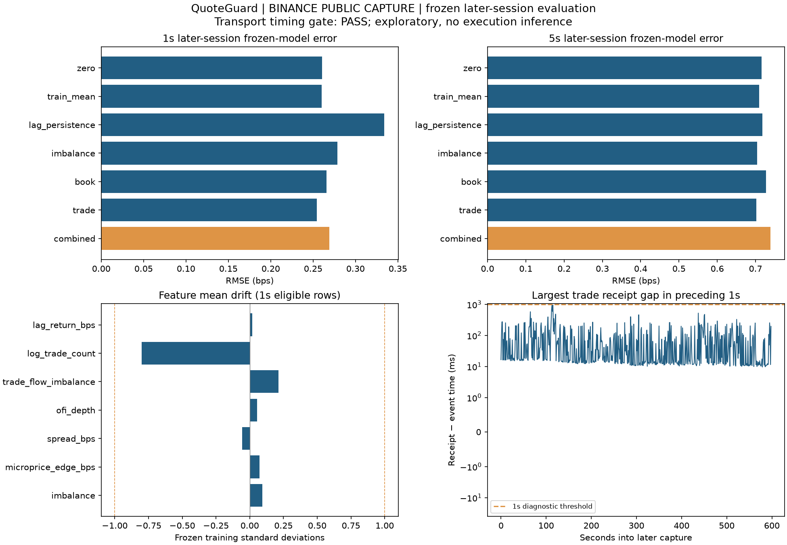
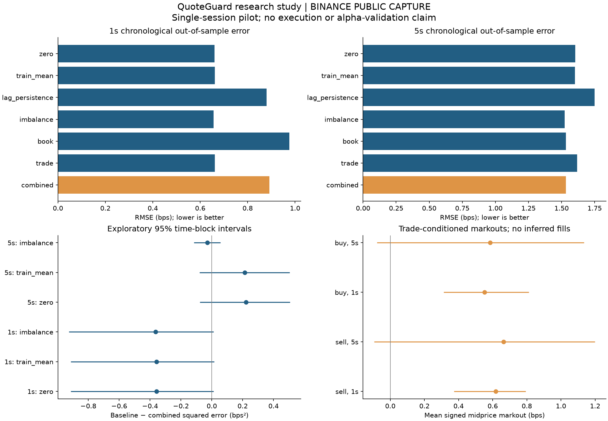

# QuoteGuard

**Crypto Market Microstructure & Adverse Selection Research**

A Python research pipeline for public Binance Spot level-1 quotes and individual
trades. It studies whether best-quote order flow and aggressive trade direction
are associated with subsequent midprice movements, using causal features,
chronological forecasts, simple baselines and dependence-aware uncertainty.

## Latest: frozen later-session test

The project now contains **205,370 real BTCUSDT events across two recordings**.
The second capture has 60,582 events and was evaluated with a JSON model frozen
before it began: no test-session refitting or normalization. Its transport timing
gate passed, with one connection and no recorded disconnects.

| Later-session horizon | Zero-return RMSE | Frozen combined RMSE |
|---|---:|---:|
| 1s | 0.260491 bps | 0.269235 bps |
| 5s | 0.716083 bps | 0.738618 bps |

The combined model has higher error at both horizons. Its 93.33% conditional 1s
nonflat-target hit rate uses only 90 of 597 targets and does not imply good overall
forecast magnitude or profitability. Drift and quality diagnostics are exposed.
This is a separate same-day test, not independent-day alpha validation.

[Read the later-session case study](FROZEN_CASE_STUDY.md) or
[inspect the complete frozen report](reports/frozen-holdout/holdout.md).



## Recorded pilot

The included real BTCUSDT capture contains **144,788 events**: **109,635 quotes**
and **35,153 trades**, over **598.86 seconds**. Four connections and three keepalive
failures are recorded. Source messages, receipt clocks, parameters, input SHA-256,
model coefficients and out-of-sample predictions are preserved for reproduction.

[Read the concise case study](CASE_STUDY.md),
[inspect the full research study](reports/live-study/study.md),
[inspect the descriptive report](reports/live-descriptive/report.md), and inspect the documented methods and limitations below.

| Horizon | Zero-return OOS RMSE | Combined-model OOS RMSE | Observation |
|---|---:|---:|---|
| 1s | 0.660875 bps | 0.891946 bps | Combined model has higher error |
| 5s | 1.604741 bps | 1.533865 bps | Lower point error; uncertainty remains |

All six primary paired forecast-improvement intervals include zero. The ten-minute
session does not establish durable predictability. Its p99 trade receipt-minus-event
time difference is about 19.47 seconds, so arrival-time distortions are a material
limitation. Those differences are not calibrated network latency measurements.
The study reports the unsuccessful comparisons and data-quality problems explicitly.



## Frozen later-session validation

Version 0.3 adds a separate training-artifact and later-recording workflow. Models
and all scaling state are frozen in fingerprinted JSON before the later capture;
held-out inference cannot refit. Source/symbol and strict temporal separation are
checked. Feature-quality sensitivity, drift diagnostics and independent scoring
audits are exported alongside the complete primary results.

```sh
# Complete train/freeze/later-session/audit workflow, offline and SYNTHETIC:
python -m quoteguard session-demo --out reports/session-demo

# Use the existing frozen pilot model on a strictly later recording:
python -m quoteguard holdout --model models/pilot-frozen.json --input data/btcusdt-research-02.jsonl --out reports/frozen-holdout
python -m quoteguard audit --model models/pilot-frozen.json --input data/btcusdt-research-02.jsonl --report reports/frozen-holdout --out reports/frozen-holdout/audit.json
```

See [the frozen-model contract](FROZEN_MODELS.md) and [the later-session protocol](SESSION_PROTOCOL.md).
The session-demo report is explicitly synthetic. The recorded frozen-holdout report
uses the separate real session. A later same-day capture
is distinct from independent-day validation.

## Repository contents and data availability

This repository publishes source, tests, the deterministic synthetic fixture,
frozen model state, research protocols and selected aggregate reports/plots.
Raw live captures, event-level analysis tables, machine logs and local working
notes are excluded. The observed capture counts and hashes remain documented;
the raw exchange recordings are not distributed through this repository.

The offline demo and `session-demo` run from a fresh checkout. Commands referring
to `data/btcusdt-research-01.jsonl` or `data/btcusdt-research-02.jsonl` require those
local captures. To reproduce the pipeline on new observations, use `collect` with
a fresh filename, then `study` or the frozen-model workflow. Local archival bundles
may include recordings; that does not mean they are available in this repository.

## Run locally

Requires Python 3.11+. Tested locally on Python 3.12.1.

```sh
python3 -m venv .venv
source .venv/bin/activate
python -m pip install -e '.[test,system-trust]'
python -m quoteguard demo --out reports/demo
python -m pytest -q
```

The demo runs offline after installation and visibly labels all data **SYNTHETIC**.
The deterministic fixture uses seed 17 and uncalibrated random prices; it is never
presented as exchange evidence. The real-data study above uses only the recorded file.
For the exact tested research runtime, install `requirements-lock.txt` before the
editable package. Version pins describe the tested Python 3.12 environment; older
Python versions may require a different dependency resolution.

```sh
# Reproduce the actual captured-data study included in the project bundle:
python -m quoteguard study --input data/btcusdt-research-01.jsonl --out reports/reproduced-study

# Independently check saved metrics and split timing:
python -m quoteguard audit --input data/btcusdt-research-01.jsonl --study reports/live-study --out reports/live-study/audit.json

# A fresh bounded public capture; use a new output filename each time:
python -m quoteguard collect --symbol BTCUSDT --minutes 20 --system-trust --out data/session-02.jsonl
python -m quoteguard analyze --input data/session-02.jsonl --out reports/session-02
python -m quoteguard study --input data/session-02.jsonl --out reports/session-02-study

# Exercise the full study offline:
python -m quoteguard study --input data/synthetic.jsonl --out reports/study-demo
```

`--no-sensitivity` skips the sampling/freshness sweep for a quicker study run.
`analyze` accepts `--stale-seconds` and `--future-tolerance-seconds`.
The `study` command uses the fixed protocol in RESEARCH_PROTOCOL.md rather than
choosing parameters after seeing the outcomes.

## Data capture and provenance

One documented public combined connection subscribes to `btcusdt@bookTicker` and
`btcusdt@trade`, without an account, credentials or order-placement endpoints.
Raw JSONL contains the original message text, UTC nanosecond receipt timestamp,
formatted UTC receipt string, monotonic receipt clock and connection ID. Capture
uses a bounded 256-frame WebSocket buffer and flushes raw records as they arrive.
Application receipt is not the network-interface timestamp; buffering can matter.

Collection retries transient disconnects with exponential backoff capped at 30s,
stops after the requested duration, and preserves metadata and raw records on
interruption. Output creation is exclusive: existing captures are never overwritten.
Analyze each recording separately; do not concatenate clock epochs or captures.

`--system-trust` uses the native OS certificate store through the optional truststore
extra. Certificate-chain and hostname checks remain enabled; no global SSL monkey
patch or verification bypass is used. This resolved the initial local Python
certificate-store failure. Without this flag, standard Python TLS verification is
used. If the public endpoint is unavailable, the CLI preserves the error and points
to the offline demo. It never substitutes synthetic events into a live capture.

Validation rejects corrupt messages, nonfinite/nonpositive prices or sizes,
crossed quotes, malformed timestamps, receive-clock regressions and duplicate or
decreasing IDs per symbol/stream. Locked markets are allowed. Quote update IDs and
trade exchange event/trade times are retained. Standard bookTicker has no comparable
exchange event timestamp; none is invented. The input fingerprint identifies the
exact bytes analyzed, not cryptographic proof of venue origin or message completeness.

The `EventAdapter` protocol and optional loader injection isolate venue parsing.
Another adapter must supply the same validated event schema and provenance; only
Binance capture is implemented here. No synchronized full-depth book is claimed.

## Features and time alignment

For best bid/ask `b,a` and sizes `B,A`:

- Midprice: `(b+a)/2`.
- Spread: `10000*(a-b)/mid` basis points.
- Quantity imbalance: `(B-A)/(B+A)`.
- Microprice: `(a*B+b*A)/(B+A)`; microprice edge is `10000*(microprice/mid-1)`.
- Aggressor sign: `-1` when Binance `m=true` (buyer is maker, aggressive sell),
  and `+1` when `m=false`.

Best-quote OFI sums the transition contributions
`I(b_n>=b_prev)*B_n - I(b_n<=b_prev)*B_prev - I(a_n<=a_prev)*A_n + I(a_n>=a_prev)*A_prev`
over the preceding second and divides by currently observed `B+A`. The first quote
of each connection has unknown transition OFI and contributes zero. This is an
adaptation of the level-1 construction in Cont, Kukanov and Stoikov, not an
identification of individual orders or a replication of their empirical results.

Trailing aggressive volume imbalance is `sum(sign*qty)/sum(qty)`, defined as zero
when no trade occurs; log trade count distinguishes an inactive window. Lag return
uses a quote already available one second earlier. Trailing windows are `(t-1s,t]`.

Trade baseline features use only the last previously received quote. File sequence
resolves equal receipt timestamps. Stale or unmatched quotes produce missing trade
features and markouts. Regular study snapshots use all messages received by each
UTC grid tick, including messages exactly at the tick. Sampling excludes stale
quotes, incomplete lookback windows and known reconnect boundaries.

Targets select the **first quote at or after** observation receipt time plus 1s/5s,
within a maximum delay of .5s. No earlier quote, future interpolation or carried
terminal price is substituted. Target timestamps and sampling delays are exported.
A target in another recorded connection is unavailable. The trade markout is
`sign*10000*(future_mid/baseline_mid-1)`, measured from the prior midprice, not the
trade execution price. Positive values are adverse movement for a hypothetical
passive counterparty. No trade is assumed to be our fill.

## Evaluation protocol

The primary study uses a regular 1s grid, a 1s quote-age limit and 1s trailing windows.
Three expanding folds train on the first 40%, 60% and 80% of the regular timeline;
each tests the next 20%. Boundaries are defined before dropping missing rows.
Training labels must be realized strictly before test-start minus a 1s embargo.

Seven comparisons share the same eligible test rows: zero return, training mean,
previous-1s-return persistence, imbalance-only ridge, book-only ridge, trade-only
ridge and combined ridge. All feature means/scales use training rows only.
Ridge minimizes `||y-mean(y)-Z*beta||² + 10*||beta||²`; the intercept is unpenalized.
The penalty and feature sets were fixed before inspecting the pilot's outcomes.

Reported metrics include RMSE, MAE, correlation and nonflat-target directional
accuracy. Neutral predictions count as incorrect on nonflat targets. A high
conditional hit rate can coexist with poor magnitude forecasts and is not evidence
of a profitable strategy.

Paired OOS squared-error differences and buy/sell markout means use nonoverlapping
time-block bootstrap intervals: 1,000 resamples, 30s blocks, seed 17. Intervals are
suppressed below 8 blocks and flagged below 20. The OOS pilot has only 12 primary
blocks. Sensitivity tables include 10s/60s blocks and the full grid of sampling
{1s,2s}, quote age {.25s,1s}, target tolerance {.1s,.5s}. No best grid cell is promoted
to the headline result. Intervals are exploratory and unadjusted for multiple tests.

## Architecture and artifacts

```text
public WebSocket -> collector.py -> raw JSONL + capture metadata
                                      |
                            events.py / EventAdapter
                                      |
                     analysis.py -> descriptive report.py
                                      |
                  sampling.py -> evaluation.py -> study.py
fixture.py -> synthetic JSONL ---------^
```

| Study artifact | Purpose |
|---|---|
| `study.md`, `study.png` | Findings, model comparisons, intervals, caveats |
| `summary.json` | Provenance, input SHA-256, coverage, runtime and capture diagnostics |
| `audit.json` | Independent saved-metric, target-row and purge checks |
| `samples.csv` | Regular-grid features, future targets and eligibility |
| `predictions.csv` | OOS timestamps, folds, targets and every model forecast |
| `splits.csv` | Purge cutoffs, latest training-label times and fold counts |
| `coefficients.csv` | Training means/scales, intercepts and ridge coefficients |
| `metrics.csv` | Recomputable OOS forecast metrics |
| `paired_intervals.csv`, `block_sensitivity.csv` | Paired-error intervals and block-length sensitivity |
| `markout_intervals.csv`, `sensitivity.csv` | Side-conditioned markouts and full parameter sweep |

`analyze` additionally writes per-event quote/trade CSVs, spread distributions,
imbalance buckets, side means and descriptive charts. Reports are deterministic for
the same input and parameters in the pinned runtime; fonts/platform versions can
change rendered image bytes across environments.

The suite currently has **77 passing tests**, including no-lookahead invariants,
actual-label-time purging, train-only scaling, reconnect isolation, known-signal
recovery, dependence-aware intervals, exact fixture replay and CLI paths. A hosted
CI workflow for Python 3.11/3.12 is included; hosted execution is not claimed.
See VALIDATION.md for executed commands and measured outputs.

## Limits and next experiment

This is a single ten-minute pilot with transport delays and reconnect gaps. Local
receipt order cannot establish exchange causality. Repeated quotes, overlapping
labels, clustered trades and shared training history remain dependent. Parser
validity does not prove complete capture. Longer independent sessions, held-out days,
clock/transport auditing and regime stability are required before stronger inference.
There is no order execution, queue model, maker-fill assumption, fees, inventory P&L,
leverage or profitability claim.

The next experiment should freeze the existing model and evaluate independent
later sessions on a more stable transport, rather than tune to this pilot.
The case studies document the findings, methodology and limitations for review.

## Sources

- [Binance Spot public WebSocket stream documentation](https://developers.binance.com/docs/binance-spot-api-docs/web-socket-streams).
- [Cont, Kukanov & Stoikov — The Price Impact of Order Book Events](https://arxiv.org/abs/1011.6402).
- [Truststore: native system certificate verification](https://truststore.readthedocs.io/en/latest/).
