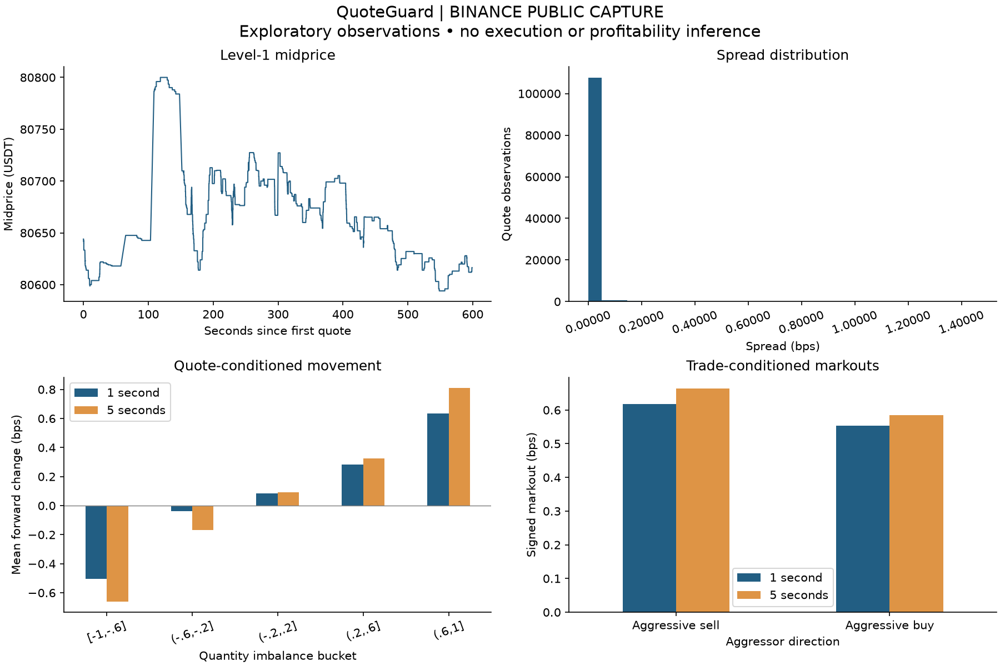

# QuoteGuard research report — BINANCE PUBLIC CAPTURE

Source: `binance_public`. Input SHA-256: `190c6cd8887d9a2cf3169039f7ab2bdee4de0831a70fe420407320a1b9a42089`.

Recording window: 2026-10-26T15:19:23.615103000Z to 2026-10-26T15:29:22.474981000Z.
Raw records: 144788; valid: 144788 (100.00%); quotes: 109635; trades: 35153.
Trades with eligible prior quote: 34873; stale or unmatched: 280.

Maximum quote age: 1s. Maximum forward sampling delay: 0.5s.
Available forward labels: `{"quote_labels": {"1s": 106001, "5s": 103930}, "trade_labels": {"1s": 33843, "5s": 33266}}`.

## Spread distribution (bps)

| Percentile | Spread |
|---|---:|
| 0% | 0.001238 |
| 25% | 0.001239 |
| 50% | 0.001240 |
| 75% | 0.001240 |
| 95% | 0.001241 |
| 100% | 1.458648 |

## Imbalance buckets

| Bucket | Quotes | 1s count | 1s mean bps | 5s count | 5s mean bps |
|---|---:|---:|---:|---:|---:|
| [-1,-.6] | 47173 | 45465 | -0.503525 | 44721 | -0.660243 |
| (-.6,-.2] | 10537 | 10096 | -0.039842 | 9725 | -0.167858 |
| (-.2,.2] | 9991 | 9586 | 0.085441 | 9472 | 0.093495 |
| (.2,.6] | 11593 | 11465 | 0.281708 | 11318 | 0.325300 |
| (.6,1] | 30341 | 29389 | 0.633657 | 28694 | 0.809601 |

## Trade-conditioned markouts

| Aggressor | Trades | 1s count | 1s mean bps | 5s count | 5s mean bps |
|---|---:|---:|---:|---:|---:|
| Sell | 17902 | 17321 | 0.617798 | 17124 | 0.663714 |
| Buy | 17251 | 16522 | 0.552807 | 16142 | 0.584284 |

## Interpretation and limitations

Positive aggressor-signed markouts indicate adverse price movement for a hypothetical passive counterparty. These are trade-conditioned midprice markouts, without inferred fills, queue position, fees, inventory, or P&L.

Features use receive order and the last available quote, including file order to resolve equal timestamps. Forward labels use the first quote at or after receipt time plus the horizon, within tolerance. Unavailable labels remain missing; counts differ by horizon. Standard bookTicker has no comparable exchange event timestamp.

Receive clocks describe local arrival order, not exchange causality. Network delay, buffering, disconnects, clock adjustments and asynchronous streams limit sequencing accuracy. ID gaps are possible; level-1 data is not a synchronized full order book.

Each quote update receives equal weight; this is not a time-weighted estimate. Overlapping horizons and clustered trades make observations dependent. No statistical significance or predictive alpha is established; longer sessions, independent days, held-out evaluation and dependence-aware inference are needed.

This report describes a short real capture only; it is exploratory and cannot validate a trading strategy.

Rejected records: `{}`.
