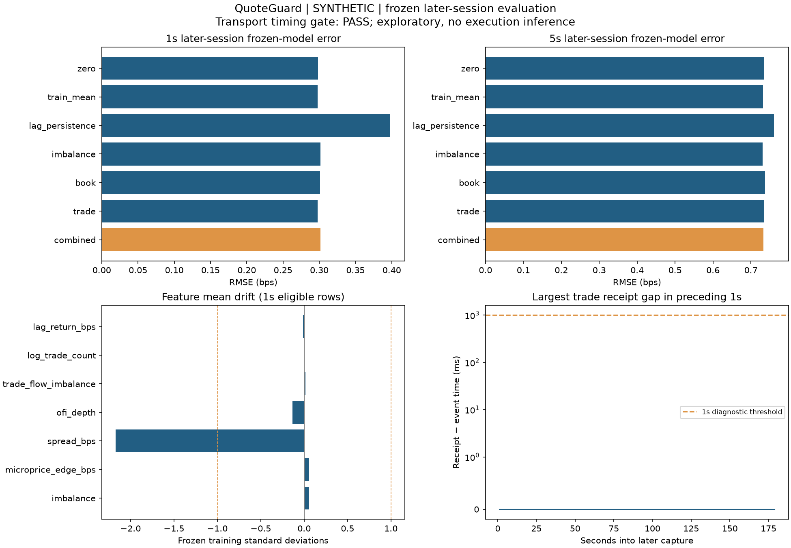

# QuoteGuard frozen later-session evaluation — SYNTHETIC

Model artifact: `879234686cf62167e887ff1540b68d584285dc3ac4d37363c0d689b86ea6590f`.
Training input SHA-256: `9427fa285b477eddca230abcebcb178c1f39b12aec66e68b118bb8328a45da48`.
Test input SHA-256: `66c78ac53de6181153b76b69427f36c64c951b0ce7e731f829b52ddf61008544`.

New capture: 2026-01-01T00:05:00.000000000Z to 2026-01-01T00:07:59.920000000Z (179.92s), 3,600 raw records; 1,800 quotes and 1,800 trades.
The new recording starts 180.08s after the training recording ends.

## Frozen protocol and findings

Every model coefficient, feature mean/scale and training-mean baseline was fixed in a fingerprinted JSON artifact before this capture. There is no test-session refit, normalization or parameter selection. Source, symbol and strict temporal separation are validated. The quality thresholds were fixed in SESSION_PROTOCOL.md before inspecting these outcomes.

- 1s: combined RMSE 0.301510 bps; zero baseline 0.298271 bps; imbalance-only 0.301544 bps. Nonflat targets: 178/178; directional accuracy is conditional on those nonflat targets.
- 5s: combined RMSE 0.733218 bps; zero baseline 0.734914 bps; imbalance-only 0.731092 bps. Nonflat targets: 174/174; directional accuracy is conditional on those nonflat targets.

**Transport timing gate: PASS.** The gate checks trade receipt-gap p99 <=1s and at least 80% of grid snapshots without a flagged trade in their previous 1s window. Passing does not establish synchronized clocks or exchange-time quote sequencing. Failing weakens timing inference; it does not hide or replace the primary results.

This is a separate later recording on the same day. It does not establish independent-day or regime robustness.

## Forecast metrics

| scope | horizon_s | model | n | nonflat_targets | rmse_bps | mae_bps | correlation | nonflat_directional_accuracy |
| --- | --- | --- | --- | --- | --- | --- | --- | --- |
| all_eligible | 1 | book | 178 | 178 | 0.30126 | 0.238632 | -0.0206782 | 0.494382 |
| all_eligible | 1 | combined | 178 | 178 | 0.30151 | 0.237413 | 0.0619147 | 0.550562 |
| all_eligible | 1 | imbalance | 178 | 178 | 0.301544 | 0.241763 | -0.17217 | 0.438202 |
| all_eligible | 1 | lag_persistence | 178 | 178 | 0.398005 | 0.315152 | 0.107643 | 0.55618 |
| all_eligible | 1 | trade | 178 | 178 | 0.297927 | 0.238406 | 0.0443291 | 0.47191 |
| all_eligible | 1 | train_mean | 178 | 178 | 0.298004 | 0.239052 | NA | 0.477528 |
| all_eligible | 1 | zero | 178 | 178 | 0.298271 | 0.237286 | NA | 0 |
| all_eligible | 5 | book | 174 | 174 | 0.737449 | 0.590199 | 0.362736 | 0.557471 |
| all_eligible | 5 | combined | 174 | 174 | 0.733218 | 0.593851 | 0.375042 | 0.591954 |
| all_eligible | 5 | imbalance | 174 | 174 | 0.731092 | 0.579913 | 0.0734562 | 0.511494 |
| all_eligible | 5 | lag_persistence | 174 | 174 | 0.760946 | 0.60722 | 0.110447 | 0.522989 |
| all_eligible | 5 | trade | 174 | 174 | 0.734191 | 0.582189 | -0.049076 | 0.511494 |
| all_eligible | 5 | train_mean | 174 | 174 | 0.73179 | 0.581424 | NA | 0.511494 |
| all_eligible | 5 | zero | 174 | 174 | 0.734914 | 0.57549 | NA | 0 |
| feature_quality_subset | 1 | book | 178 | 178 | 0.30126 | 0.238632 | -0.0206782 | 0.494382 |
| feature_quality_subset | 1 | combined | 178 | 178 | 0.30151 | 0.237413 | 0.0619147 | 0.550562 |
| feature_quality_subset | 1 | imbalance | 178 | 178 | 0.301544 | 0.241763 | -0.17217 | 0.438202 |
| feature_quality_subset | 1 | lag_persistence | 178 | 178 | 0.398005 | 0.315152 | 0.107643 | 0.55618 |
| feature_quality_subset | 1 | trade | 178 | 178 | 0.297927 | 0.238406 | 0.0443291 | 0.47191 |
| feature_quality_subset | 1 | train_mean | 178 | 178 | 0.298004 | 0.239052 | NA | 0.477528 |
| feature_quality_subset | 1 | zero | 178 | 178 | 0.298271 | 0.237286 | NA | 0 |
| feature_quality_subset | 5 | book | 174 | 174 | 0.737449 | 0.590199 | 0.362736 | 0.557471 |
| feature_quality_subset | 5 | combined | 174 | 174 | 0.733218 | 0.593851 | 0.375042 | 0.591954 |
| feature_quality_subset | 5 | imbalance | 174 | 174 | 0.731092 | 0.579913 | 0.0734562 | 0.511494 |
| feature_quality_subset | 5 | lag_persistence | 174 | 174 | 0.760946 | 0.60722 | 0.110447 | 0.522989 |
| feature_quality_subset | 5 | trade | 174 | 174 | 0.734191 | 0.582189 | -0.049076 | 0.511494 |
| feature_quality_subset | 5 | train_mean | 174 | 174 | 0.73179 | 0.581424 | NA | 0.511494 |
| feature_quality_subset | 5 | zero | 174 | 174 | 0.734914 | 0.57549 | NA | 0 |

No grid windows were flagged by the feature-quality rule in this recording, so the primary and feature-quality subset metrics are identical.

The feature-quality subset uses only receipt-time information: in the preceding 1s, no received trade may have receipt-minus-event time >1s or <-100ms. No model is refit. Subset and primary metrics have different samples, so differences are not a controlled forecast-improvement comparison. Quote exchange timestamps remain unavailable.

## Paired time-block intervals

| scope | horizon_s | comparison | mean | ci_low | ci_high | blocks | status |
| --- | --- | --- | --- | --- | --- | --- | --- |
| all_eligible | 1 | zero_minus_combined_squared_error | -0.0019425 | NA | NA | 6 | insufficient_blocks |
| all_eligible | 1 | train_mean_minus_combined_squared_error | -0.00210194 | NA | NA | 6 | insufficient_blocks |
| all_eligible | 1 | imbalance_minus_combined_squared_error | 2.06079e-05 | NA | NA | 6 | insufficient_blocks |
| all_eligible | 5 | zero_minus_combined_squared_error | 0.00249028 | NA | NA | 6 | insufficient_blocks |
| all_eligible | 5 | train_mean_minus_combined_squared_error | -0.00209281 | NA | NA | 6 | insufficient_blocks |
| all_eligible | 5 | imbalance_minus_combined_squared_error | -0.00311282 | NA | NA | 6 | insufficient_blocks |
| feature_quality_subset | 1 | zero_minus_combined_squared_error | -0.0019425 | NA | NA | 6 | insufficient_blocks |
| feature_quality_subset | 1 | train_mean_minus_combined_squared_error | -0.00210194 | NA | NA | 6 | insufficient_blocks |
| feature_quality_subset | 1 | imbalance_minus_combined_squared_error | 2.06079e-05 | NA | NA | 6 | insufficient_blocks |
| feature_quality_subset | 5 | zero_minus_combined_squared_error | 0.00249028 | NA | NA | 6 | insufficient_blocks |
| feature_quality_subset | 5 | train_mean_minus_combined_squared_error | -0.00209281 | NA | NA | 6 | insufficient_blocks |
| feature_quality_subset | 5 | imbalance_minus_combined_squared_error | -0.00311282 | NA | NA | 6 | insufficient_blocks |

Positive paired error differences favor the combined model. Primary 30s blocks, 1,000 resamples, seed 17; 10s/60s alternatives are in block_sensitivity.csv. Few blocks and multiple comparisons make these pointwise intervals exploratory.

## Train-to-test feature drift

| horizon_s | feature | mean_in_train_std | test_std_in_train_std | fraction_abs_z_above_3 | flag_mean_shift |
| --- | --- | --- | --- | --- | --- |
| 1 | imbalance | 0.0547107 | 1.07933 | 0 | False |
| 1 | microprice_edge_bps | 0.0547263 | 1.07905 | 0 | False |
| 1 | spread_bps | -2.17301 | 1.16374 | 0.264045 | True |
| 1 | ofi_depth | -0.136924 | 1.02587 | 0.0224719 | False |
| 1 | trade_flow_imbalance | 0.0151489 | 0.939412 | 0 | False |
| 1 | log_trade_count | -1.77636e-15 | 0 | 0 | False |
| 1 | lag_return_bps | -0.0151037 | 1.03501 | 0.00561798 | False |
| 5 | imbalance | 0.0405914 | 1.09333 | 0 | False |
| 5 | microprice_edge_bps | 0.0406112 | 1.09304 | 0 | False |
| 5 | spread_bps | -2.27215 | 1.2044 | 0.293103 | True |
| 5 | ofi_depth | -0.120293 | 1.01559 | 0.0229885 | False |
| 5 | trade_flow_imbalance | 0.00999459 | 0.940606 | 0 | False |
| 5 | log_trade_count | -1.33227e-15 | 0 | 0 | False |
| 5 | lag_return_bps | 0.00588027 | 1.03322 | 0.00574713 | False |

Drift uses the combined model's frozen training mean and scale. A mean shift above one training standard deviation is flagged descriptively. Constant training columns use the model's unit-scale fallback, so those ratios require care. Drift is not proof of cause.

## Quality and provenance

Training transport: `{"gap_median_ms": 0.0, "gap_p99_ms": 0.0, "scope": "observable trailing features only; no quote exchange timestamps exist", "snapshot_quality_fraction": 1.0, "thresholds": {"max_p99_ms": 1000, "max_trade_gap_ms": 1000, "min_snapshot_fraction": 0.8, "min_trade_gap_ms": -100}, "timing_gate_passed": true, "trade_count": 1200, "trades_above_1s": 0, "trades_below_minus_100ms": 0}`.
Test transport: `{"gap_median_ms": 0.0, "gap_p99_ms": 0.0, "scope": "observable trailing features only; no quote exchange timestamps exist", "snapshot_quality_fraction": 1.0, "thresholds": {"max_p99_ms": 1000, "max_trade_gap_ms": 1000, "min_snapshot_fraction": 0.8, "min_trade_gap_ms": -100}, "timing_gate_passed": true, "trade_count": 1800, "trades_above_1s": 0, "trades_below_minus_100ms": 0}`.
Grid coverage: `{"eligible_features": 179, "grid_observations": 180, "interval_s": 1, "labeled_1s": 178, "labeled_5s": 174, "lookback_s": 1, "stale_s": 1, "tolerance_s": 0.5}`.

Receipt gaps mix clock offset, timestamp semantics, transport buffering and application scheduling. The collector reports event-loop and disk-write telemetry when available, without treating it as a latency benchmark. Raw captures retain reconnect boundaries.

Model IDs detect accidental changes, not malicious tampering or venue authenticity. No order fills, queue position, trading P&L, fees or profitable strategy are inferred. Next validation requires independent later days and stable timestamp/transport behavior.
