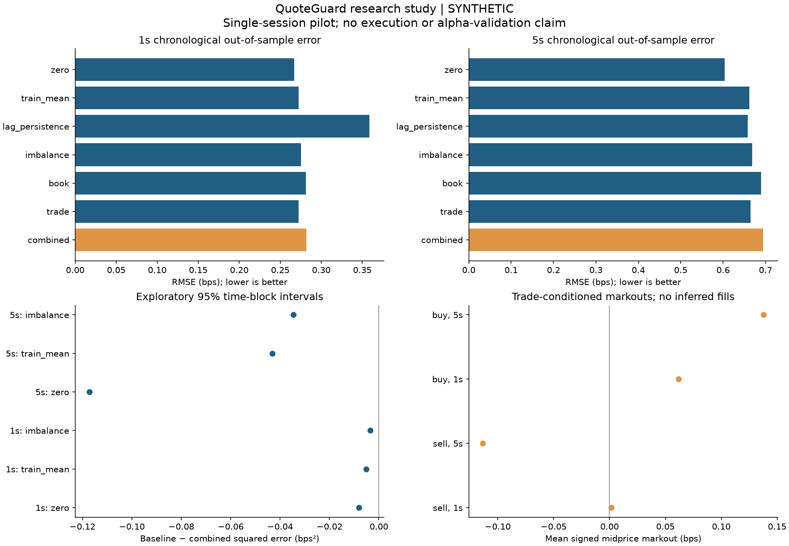

# QuoteGuard — chronological research study (SYNTHETIC)

Symbol: **BTCUSDT**. Source: `synthetic`. Input SHA-256: `9427fa285b477eddca230abcebcb178c1f39b12aec66e68b118bb8328a45da48`.

UTC window: 2026-01-01T00:00:00.000000000Z to 2026-01-01T00:01:59.920000000Z (119.92s). Valid records: 2,400/2,400; quotes: 1,200; trades: 1,200.

## Findings

- At 1s, the combined model's OOS RMSE was 0.281593 bps versus 0.266924 bps for zero return (higher error). This is a single-session comparison, not evidence of durable predictability.
- At 5s, the combined model's OOS RMSE was 0.694125 bps versus 0.603785 bps for zero return (higher error). This is a single-session comparison, not evidence of durable predictability.

The model penalty, feature sets, split fractions and sensitivity grid were fixed in RESEARCH_PROTOCOL.md before inspecting the session outcomes. No best-performing sensitivity configuration was substituted for the baseline protocol.

## Method

Regular 1s receive-time grid; last available quote <=1s old. Past 1s best-quote OFI, signed aggressive volume, count, quantity imbalance, microprice edge, spread and lagged return. Future targets select the first quote at/after 1s or 5s, at most .5s late. Known reconnect boundaries invalidate carried features and targets.

Three expanding chronological folds train on the initial 40%, 60%, and 80% of the timeline. Each tests the following 20%. Training labels must be realized strictly before test start minus a 1s embargo. Means/scales and ridge coefficients use training rows only. Alpha=10 is fixed; no shuffled split, test-time fitting or hyperparameter search is used.

## Out-of-sample metrics

| horizon_s | model | n | rmse_bps | mae_bps | correlation | nonflat_directional_accuracy |
| --- | --- | --- | --- | --- | --- | --- |
| 1 | book | 71 | 0.281307 | 0.218495 | -0.166928 | 0.450704 |
| 1 | combined | 71 | 0.281593 | 0.223973 | -0.0541222 | 0.478873 |
| 1 | imbalance | 71 | 0.275184 | 0.215155 | -0.288137 | 0.521127 |
| 1 | lag_persistence | 71 | 0.358707 | 0.275258 | 0.0929211 | 0.56338 |
| 1 | trade | 71 | 0.272257 | 0.216049 | -0.0983418 | 0.507042 |
| 1 | train_mean | 71 | 0.272271 | 0.211816 | -0.263261 | 0.464789 |
| 1 | zero | 71 | 0.266924 | 0.207648 | NA | 0 |
| 5 | book | 67 | 0.689069 | 0.533813 | -0.30698 | 0.41791 |
| 5 | combined | 67 | 0.694125 | 0.540188 | -0.270557 | 0.41791 |
| 5 | imbalance | 67 | 0.668685 | 0.525055 | -0.499975 | 0.462687 |
| 5 | lag_persistence | 67 | 0.658007 | 0.482597 | 0.0126477 | 0.537313 |
| 5 | trade | 67 | 0.664709 | 0.5245 | -0.438425 | 0.447761 |
| 5 | train_mean | 67 | 0.662297 | 0.519586 | -0.526268 | 0.492537 |
| 5 | zero | 67 | 0.603785 | 0.454138 | NA | 0 |

Directional accuracy excludes flat targets; neutral predictions count as incorrect. Models are compared on the same eligible rows per horizon. These are return forecasts, without spreads, fees, inventory or execution assumptions.

## Paired error comparison

Positive values mean the combined model has lower squared error than the named baseline. Intervals use 1,000 bootstrap resamples of 30s time blocks. Intervals are suppressed below 8 blocks, and fewer than 20 blocks are flagged as especially unstable.

| horizon_s | comparison | mean | ci_low | ci_high | blocks | status |
| --- | --- | --- | --- | --- | --- | --- |
| 1 | zero_minus_combined_squared_error | -0.00804592 | NA | NA | 3 | insufficient_blocks |
| 1 | train_mean_minus_combined_squared_error | -0.00516262 | NA | NA | 3 | insufficient_blocks |
| 1 | imbalance_minus_combined_squared_error | -0.00356795 | NA | NA | 3 | insufficient_blocks |
| 5 | zero_minus_combined_squared_error | -0.117253 | NA | NA | 3 | insufficient_blocks |
| 5 | train_mean_minus_combined_squared_error | -0.0431718 | NA | NA | 3 | insufficient_blocks |
| 5 | imbalance_minus_combined_squared_error | -0.0346694 | NA | NA | 3 | insufficient_blocks |

Block-length sensitivity (same paired errors; headline block length remains 30s):

| horizon_s | comparison | block_s | mean | ci_low | ci_high | blocks | status |
| --- | --- | --- | --- | --- | --- | --- | --- |
| 1 | zero_minus_combined_squared_error | 10 | -0.00804592 | -0.0167336 | -0.000290664 | 8 | few_blocks_exploratory |
| 1 | train_mean_minus_combined_squared_error | 10 | -0.00516262 | -0.0133926 | 0.00289581 | 8 | few_blocks_exploratory |
| 1 | imbalance_minus_combined_squared_error | 10 | -0.00356795 | -0.011875 | 0.00580502 | 8 | few_blocks_exploratory |
| 5 | zero_minus_combined_squared_error | 10 | -0.117253 | NA | NA | 7 | insufficient_blocks |
| 5 | train_mean_minus_combined_squared_error | 10 | -0.0431718 | NA | NA | 7 | insufficient_blocks |
| 5 | imbalance_minus_combined_squared_error | 10 | -0.0346694 | NA | NA | 7 | insufficient_blocks |
| 1 | zero_minus_combined_squared_error | 30 | -0.00804592 | NA | NA | 3 | insufficient_blocks |
| 1 | train_mean_minus_combined_squared_error | 30 | -0.00516262 | NA | NA | 3 | insufficient_blocks |
| 1 | imbalance_minus_combined_squared_error | 30 | -0.00356795 | NA | NA | 3 | insufficient_blocks |
| 5 | zero_minus_combined_squared_error | 30 | -0.117253 | NA | NA | 3 | insufficient_blocks |
| 5 | train_mean_minus_combined_squared_error | 30 | -0.0431718 | NA | NA | 3 | insufficient_blocks |
| 5 | imbalance_minus_combined_squared_error | 30 | -0.0346694 | NA | NA | 3 | insufficient_blocks |
| 1 | zero_minus_combined_squared_error | 60 | -0.00804592 | NA | NA | 2 | insufficient_blocks |
| 1 | train_mean_minus_combined_squared_error | 60 | -0.00516262 | NA | NA | 2 | insufficient_blocks |
| 1 | imbalance_minus_combined_squared_error | 60 | -0.00356795 | NA | NA | 2 | insufficient_blocks |
| 5 | zero_minus_combined_squared_error | 60 | -0.117253 | NA | NA | 2 | insufficient_blocks |
| 5 | train_mean_minus_combined_squared_error | 60 | -0.0431718 | NA | NA | 2 | insufficient_blocks |
| 5 | imbalance_minus_combined_squared_error | 60 | -0.0346694 | NA | NA | 2 | insufficient_blocks |

## Trade-conditioned markouts

Positive signed markouts are adverse midprice movement for a hypothetical passive counterparty. Buy/sell means use event weighting; the resampling unit is a time block, not an individual trade.

| side | horizon_s | n | mean | ci_low | ci_high | blocks | status |
| --- | --- | --- | --- | --- | --- | --- | --- |
| sell | 1 | 592 | 0.00161991 | NA | NA | 4 | insufficient_blocks |
| sell | 5 | 571 | -0.113376 | NA | NA | 4 | insufficient_blocks |
| buy | 1 | 597 | 0.0617602 | NA | NA | 4 | insufficient_blocks |
| buy | 5 | 578 | 0.137952 | NA | NA | 4 | insufficient_blocks |

## Purge audit

| horizon_s | fold | train_rows | test_rows | purged_rows | status |
| --- | --- | --- | --- | --- | --- |
| 1 | 1 | 45 | 24 | 2 | ok |
| 1 | 2 | 69 | 24 | 2 | ok |
| 1 | 3 | 93 | 23 | 2 | ok |
| 5 | 1 | 41 | 24 | 6 | ok |
| 5 | 2 | 65 | 24 | 6 | ok |
| 5 | 3 | 89 | 19 | 6 | ok |

Exact nanosecond cutoff and latest training-label timestamps are in splits.csv; train-only scaling and model coefficients are in coefficients.csv. OOS predictions retain timestamps and folds for independent error recomputation.

## Sensitivity grid

| interval_s | stale_s | tolerance_s | horizon_s | model | n | rmse_bps |
| --- | --- | --- | --- | --- | --- | --- |
| 1 | 0.25 | 0.1 | 1 | combined | 71 | 0.281593 |
| 1 | 0.25 | 0.1 | 1 | zero | 71 | 0.266924 |
| 1 | 0.25 | 0.1 | 5 | combined | 67 | 0.694125 |
| 1 | 0.25 | 0.1 | 5 | zero | 67 | 0.603785 |
| 1 | 0.25 | 0.5 | 1 | combined | 71 | 0.281593 |
| 1 | 0.25 | 0.5 | 1 | zero | 71 | 0.266924 |
| 1 | 0.25 | 0.5 | 5 | combined | 67 | 0.694125 |
| 1 | 0.25 | 0.5 | 5 | zero | 67 | 0.603785 |
| 1 | 1 | 0.1 | 1 | combined | 71 | 0.281593 |
| 1 | 1 | 0.1 | 1 | zero | 71 | 0.266924 |
| 1 | 1 | 0.1 | 5 | combined | 67 | 0.694125 |
| 1 | 1 | 0.1 | 5 | zero | 67 | 0.603785 |
| 1 | 1 | 0.5 | 1 | combined | 71 | 0.281593 |
| 1 | 1 | 0.5 | 1 | zero | 71 | 0.266924 |
| 1 | 1 | 0.5 | 5 | combined | 67 | 0.694125 |
| 1 | 1 | 0.5 | 5 | zero | 67 | 0.603785 |
| 2 | 0.25 | 0.1 | 1 | combined | 36 | 0.284784 |
| 2 | 0.25 | 0.1 | 1 | zero | 36 | 0.259299 |
| 2 | 0.25 | 0.1 | 5 | combined | 34 | 0.757416 |
| 2 | 0.25 | 0.1 | 5 | zero | 34 | 0.615063 |
| 2 | 0.25 | 0.5 | 1 | combined | 36 | 0.284784 |
| 2 | 0.25 | 0.5 | 1 | zero | 36 | 0.259299 |
| 2 | 0.25 | 0.5 | 5 | combined | 34 | 0.757416 |
| 2 | 0.25 | 0.5 | 5 | zero | 34 | 0.615063 |
| 2 | 1 | 0.1 | 1 | combined | 36 | 0.284784 |
| 2 | 1 | 0.1 | 1 | zero | 36 | 0.259299 |
| 2 | 1 | 0.1 | 5 | combined | 34 | 0.757416 |
| 2 | 1 | 0.1 | 5 | zero | 34 | 0.615063 |
| 2 | 1 | 0.5 | 1 | combined | 36 | 0.284784 |
| 2 | 1 | 0.5 | 1 | zero | 36 | 0.259299 |
| 2 | 1 | 0.5 | 5 | combined | 34 | 0.757416 |
| 2 | 1 | 0.5 | 5 | zero | 34 | 0.615063 |

## Data quality and limits

Sampling coverage: `{"eligible_features": 119, "grid_observations": 120, "interval_s": 1, "labeled_1s": 118, "labeled_5s": 114, "lookback_s": 1, "stale_s": 1, "tolerance_s": 0.5}`.
Quote interarrival gaps (ms): `{"maximum": 100.0, "median": 100.0, "p99": 100.0}`.
Receipt-gap diagnostic counts: `{"above_1s": 0, "above_5s": 0, "negative": 0}`.
Receipt minus exchange-event time (ms): `{"median": 0.0, "p99": 0.0}`.

Receipt-minus-exchange differences combine clock offset, venue timestamp semantics, transport and application scheduling; they are not calibrated latency benchmarks. Quote receipt times do not reveal exchange quote event times. Rejected-record counts describe parser validity, not proof that no messages were lost upstream.

Regular sampling reduces update-intensity weighting but does not make observations independent. Overlapping targets, repeated quotes, clustered activity and shared training histories remain. The block bootstrap assumes blocks capture enough short-range dependence; a single session has few blocks and no independent-day replication. Intervals are pointwise, unadjusted for multiple comparisons, and must not be treated as confirmatory significance tests.

Next validation: independent sessions/days, held-out sessions, longer block-length sensitivity, venue/clock diagnostics and stability under changing market regimes. There is no strategy backtest, maker-fill model, queue position, P&L or profitability claim.

**SYNTHETIC fixture: all results here validate software behavior only.**
